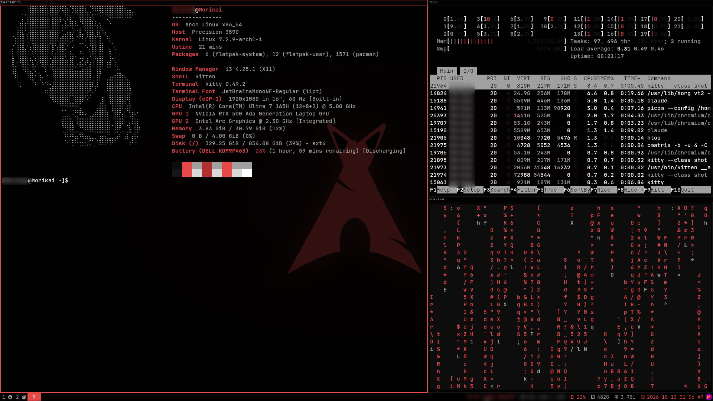

# Arch i3 Dotfiles: Black & Red

A minimal black-and-red i3 desktop for Arch Linux, built for a laptop: low power use, no desktop environment, everything driven from the keyboard.



## Features

- **Black and red theme.** The red `#E64848` accent runs through the window borders, bar, rofi, dunst and kitty.
- **Status bar with i3blocks.** The bar at the bottom shows the Spotify track, Wi-Fi, IP, battery, free disk space, memory and the clock.
- **On-screen indicators for brightness and volume.** The function keys show a dunst popup with a progress bar.
- **Lightweight compositor.** picom with vsync and fades, and no shadows or blur, to save battery.
- **Automatic screen lock.** `xss-lock` locks the screen with a plain black `i3lock` before suspend.
- **Startup apps.** Polish keyboard layout, the NetworkManager tray icon, flameshot for screenshots, and the wallpaper set by feh.

## Keybindings

`Mod` is the Super / Windows key.

| Keys | Action |
|---|---|
| `Mod+Enter` | Terminal (kitty) |
| `Mod+d` | App launcher (rofi) |
| `Mod+Shift+q` | Close window |
| `Mod+o` | Lock screen |
| `Mod+j / k / l / ;` or arrows | Move focus |
| `Mod+Shift+` the same keys | Move window |
| `Mod+h` / `Mod+v` | Split horizontally / vertically |
| `Mod+f` | Fullscreen |
| `Mod+s` / `Mod+w` / `Mod+e` | Stacked / tabbed / split layout |
| `Mod+Shift+space` | Toggle floating |
| `Mod+r` | Resize mode |
| `Mod+1…0` | Switch workspace |
| `F6` / `F7` | Brightness down / up |
| `F1` / `F2` / `F3` | Mute / volume down / up |
| `F8` | Re-detect displays |
| `Mod+Shift+c` / `Mod+Shift+r` | Reload / restart i3 |

## Contents

| Path | What |
|---|---|
| `.config/i3/` | i3 config, lock screen, i3blocks scripts (battery, Spotify) |
| `.config/i3blocks/`, `.config/i3status/` | Status bar |
| `.config/picom/` | Compositor |
| `.config/dunst/` | Notifications |
| `.config/rofi/` | Launcher |
| `.config/kitty/` | Terminal |
| `.local/bin/` | Brightness and volume OSD scripts |
| `.fehbg`, `Pictures/wallpapers/` | Wallpaper |
| `screenshots/` | Preview images |

## Install

```sh
sudo pacman -S --needed i3-wm i3blocks i3status i3lock xss-lock picom dunst rofi kitty feh \
  brightnessctl wireplumber libpulse playerctl acpi flameshot network-manager-applet dex xorg-xrandr \
  ttf-jetbrains-mono-nerd
git clone https://github.com/fondlet/arch-i3-dotfiles.git ~/dotfiles
~/dotfiles/install.sh
```

`install.sh` symlinks each file into `$HOME`. Anything already there is renamed to `<name>.pre-dotfiles`.
Because the live files are symlinks, your edits show up in the repo. Commit and push them from `~/dotfiles`.
